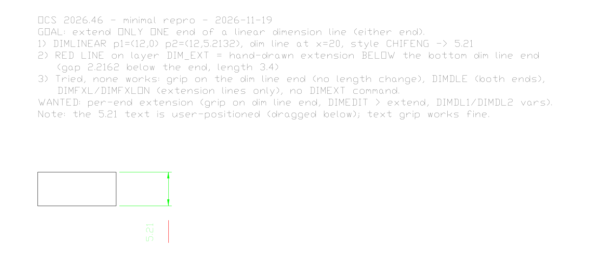

### Summary

A linear dimension's dimension line can only be extended **symmetrically** (`DIMDLE` lengthens both ends). There is no way to extend **one end only**, and dragging the existing "dimension line end" grips does not lengthen the dimension line either.

This comes up routinely in real drawings: a small dimension placed in a narrow area has to have its dimension line extended into empty space so the reader can tell which feature the value belongs to. Right now the only option is to draw a separate `LINE` next to it.

### Environment

- OpenCADStudio **2026.46** (`build_rev 8b4d27046040`), Linux — other platforms not tested
- Reporter: @fa30rapoter-debug
- Minimal DXF attached (DXF 2018, millimetres, no customer data)

### Steps to reproduce

1. `DIMLINEAR`, first extension-line origin `(12, 0)`, second `(12, 5.2132)`, dimension line at `x = 20` → shows `5.21` (style `CHIFENG`).
2. Try to extend **only one end** of the dimension line by 3.4 — in the attached file the hand-drawn red line on layer `DIM_EXT` sits below the bottom end (gap 2.2162, length 3.4).

### Actual behaviour

- No command or style variable does it: `DIMDLE` extends **both** ends; `DIMFXL` / `DIMFXLON` only affect the **extension lines**; there is no `DIMEXT`-style command; `DIMEDIT` only offers oblique (tilt) for extension lines.
- The dimension has 6 grips, two of them at the dimension line ends (`grip_id` 4 and 5, both reporting `moves_entity: true`), but dragging grip 5 from `(20, 5.2132)` to `(20, 8.6)` does nothing useful:

  | after the drag | value |
  |---|---|
  | `actual_measurement` | 5.2132 (unchanged) |
  | `first_point` / `second_point` | (12,0) / (12,5.2132) (unchanged) |
  | dimension line inside the generated block | still `(20,0) → (20,5.2132)` — no overhang |
  | only change | `definition_point.y` 0 → 3.3868, no visual effect on a vertical dimension |

- Workaround used: a plain `LINE` on a separate layer (the red line in the attachment). Because it is not part of the dimension it does not move with it, needs its own layer / plot-style handling, and is easy to miss when a drawing is revised.

### Grip read-back

Grips are only reported for **selected** entities — with nothing selected the grip list comes back empty (that alone made me think grips were unsupported):

| grip_id | position | `moves_entity` | interpretation |
|---|---|---|---|
| 0 | (12, 0) | false | first extension-line origin |
| 1 | (12, 5.2132) | true | second extension-line origin |
| 2 | (20, 2.6066) | true | dimension line position |
| 3 | (17.15, 2.6066) | false | dimension text position |
| 4 | (20, 0) | true | dimension line, lower end |
| 5 | (20, 5.2132) | true | dimension line, upper end |

### Expected behaviour (any one of these)

- **A (preferred, lowest cost):** make grips 4 and 5 actually extend the dimension line end, stored per end (e.g. `DIMDL1` / `DIMDL2`, following the existing `DIMSE1/2` and `DIMSD1/2` convention).
- **B:** add an "extend dimension line / extend extension line" sub-option to `DIMEDIT` that can be applied to one end only.
- **C:** allow extension lines with an individually specified start point and fixed length (a generalised `DIMFXL`).

### Impact

Medical-device part drawings often carry very small dimensions (this example is 5.21) whose text and tick marks must sit outside the outline. Without a per-end extension the dimension has to be faked with loose geometry, which then diverges from the dimension object on the next revision — a documentation-control problem, not just cosmetics.

### Files

Minimal repro repository: https://github.com/fa30rapoter-debug/ocs-dim-extension-repro

- [`OCS_dim_extension_repro.dxf`](https://github.com/fa30rapoter-debug/ocs-dim-extension-repro/blob/main/OCS_dim_extension_repro.dxf) — DXF 2018, mm: 12 × 5.2132 rectangle + one `DIMLINEAR` + the red hand-drawn line + 9 note lines
- [`OCS_dim_extension_preview.png`](https://github.com/fa30rapoter-debug/ocs-dim-extension-repro/blob/main/OCS_dim_extension_preview.png) — rendered preview

_No customer data in the file: the geometry is a bare rectangle created for this report._
